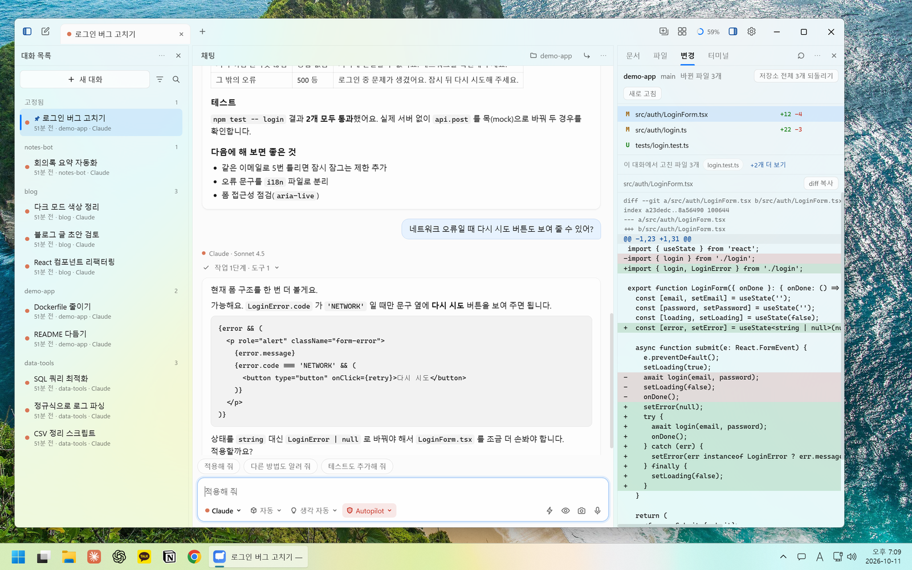
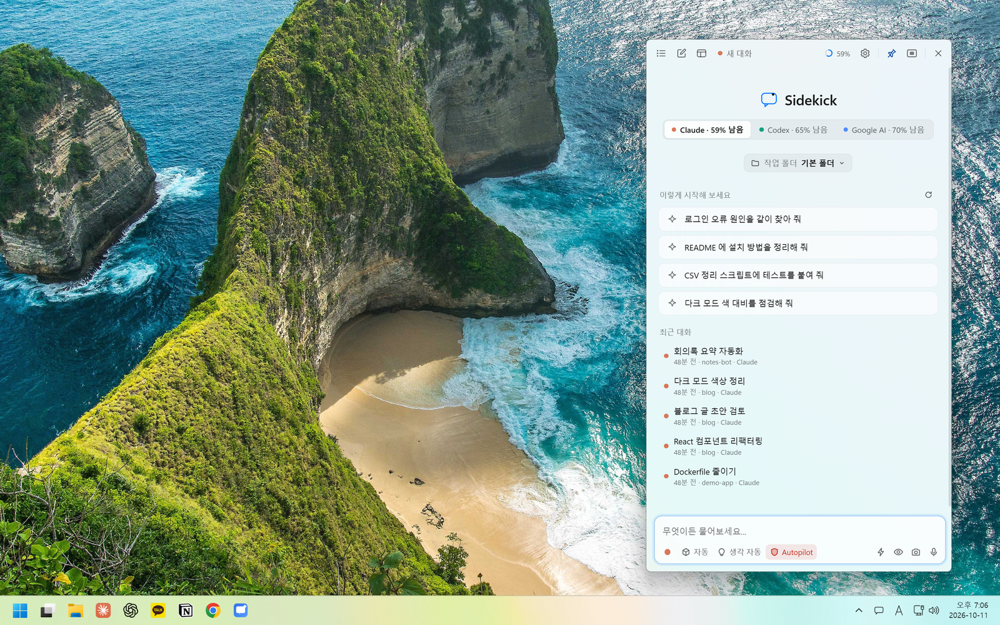
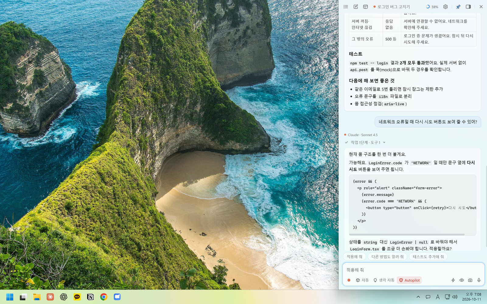
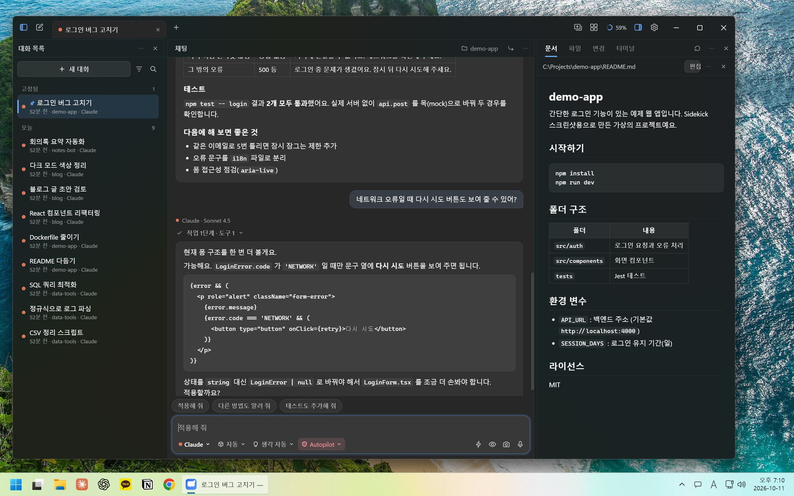
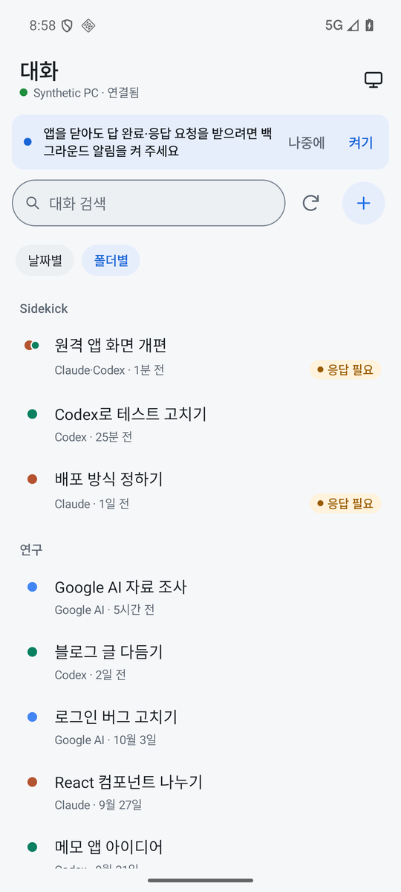
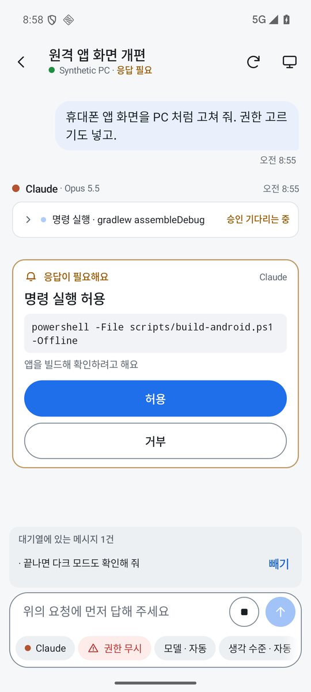
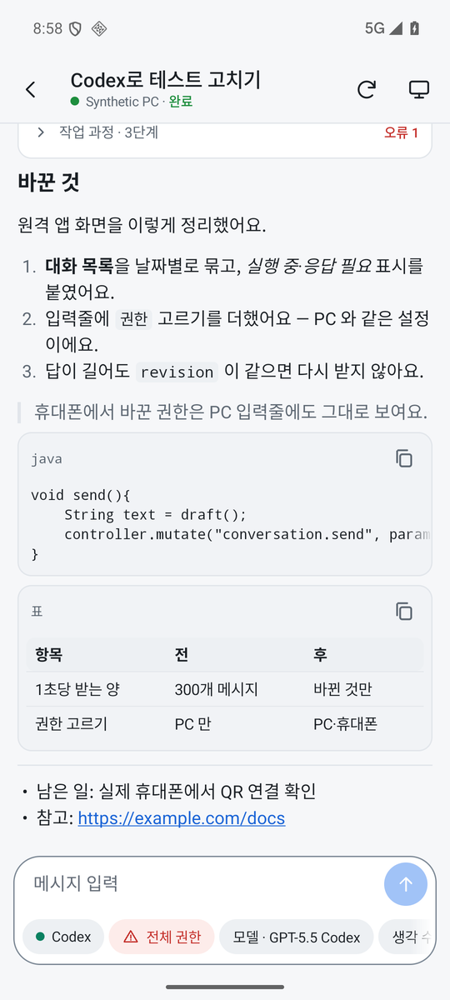
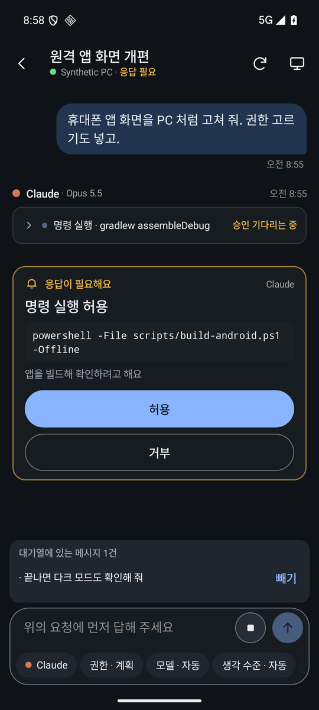

# Sidekick

[English](README.en.md)

Claude Code, Codex, Google AI(Antigravity)를 한 창에서 사용하는 Windows 11용 사이드바입니다. 각 AI의 공식 엔진을 사용하며, 로그인과 모델, MCP 서버, 플러그인, 대화 기록도 공식 앱과 공유합니다.



대화 목록은 폴더별로 정리할 수 있습니다. 오른쪽 패널에서는 AI가 수정한 파일을 확인합니다. 제목 표시줄에는 남은 사용량이, 입력창 위에는 추천 답장이 표시됩니다.

## 하는 일

### 한 대화로 여러 AI 사용

- **Claude, Codex, Google AI 전환:** 한 대화에서 AI를 번갈아 사용할 수 있습니다. Claude와 Codex는 완료된 차례가 양쪽 공식 기록에 저장되어, 공식 앱으로 옮겨도 이어서 작업할 수 있습니다. Google AI는 Sidekick에서 같은 대화로 이어서 쓸 수 있습니다.
- **빠짐없는 문맥 넘기기:** AI를 바꾸면 그 AI가 아직 보지 못한 대화를 생략 없이 넘깁니다. 이미 본 내용은 다시 보내지 않습니다. 설정한 크기를 넘으면 최근 메시지만 넣고 나머지 전문은 파일로 넘깁니다.
- **공식 엔진 그대로:** 각 AI의 공식 엔진을 사용하므로 로그인, 모델 목록, MCP 서버, 플러그인, 슬래시 명령을 공식 앱과 공유합니다. 고른 작업 폴더의 스킬은 `/` 목록 맨 앞에 나옵니다. Claude 계정 플러그인은 모두 넘길지, 스킬과 명령만 넘길지, 넘기지 않을지 설정에서 고릅니다.
- **입력창에서 설정:** AI, 모델, 추론 수준, 권한 모드, 작업 폴더를 입력창에서 고릅니다. 모델 메뉴에는 구독 요금제와 남은 사용량이 함께 표시됩니다. Claude는 추론 수준 단추에서 워크플로를 켤 수 있고, ⚡ 단추로 빠른 모드를 켭니다. 빠른 모드는 창을 닫거나 대화가 바뀌면 꺼집니다.
- **자동 모델·추론 수준:** **자동**으로 두면 차례마다 일의 난이도를 보고 모델과 추론 수준을 고릅니다. 고른 결과는 답 안의 '자동' 단계에 남습니다. 이어 가는 대화에서 모델을 바꿀지는 설정에서 '유지', '유지 안 함', '압축 후 바꾸기' 중에서 고릅니다. '압축 후 바꾸기'는 앞 모델로 대화를 먼저 압축한 뒤 새 모델로 보냅니다(Claude, Codex).
- **Autopilot:** 권한 모드의 하나로, 도구 승인과 AI의 질문에 대신 답합니다. 선택지가 있는 질문은 대신 답하지 않고 화면에 남깁니다.
- **팀 모드:** 입력줄의 **팀** 버튼으로 켜고, 켬·끔은 대화마다 기억합니다(PC·휴대폰). 고른 AI가 지휘하고 Gemini 작업자가 실제 작업을 맡습니다. Claude·Codex를 고르면 그 AI(고른 모델)가, Google AI를 고르면 Claude Opus 또는 Gemini 4 Argon이 지휘합니다. 작업자는 Google 구독(Antigravity)의 Gemini Flash로 돌고, 과제마다 지휘자가 작업자의 추론 수준을 고릅니다. 지휘자의 추론 수준, 작업자 보고 상한, 응답 대기 제한도 정합니다. 답마다 지휘자·작업자 토큰을 따로 보여 주고 팀 모드로 아낀 한도를 추정해 보여 줍니다. 작업자 대화는 목록과 동기화에서 숨겨집니다.
- **작업 폴더 바꾸기:** 시작한 대화의 폴더를 바꾸면, 고른 폴더에서 이어 받는 새 대화가 만들어집니다.
- **다른 곳에서 이어가기:** 지금 대화를 새 세션, 다른 AI, 같은 폴더의 새 대화, 새 git worktree에서 이어 가거나 대화 문맥을 복사할 수 있습니다.
- **답하는 중에도 계속:** 답하는 중에 보낸 글은 대기열에 쌓이고, 설정에 따라 바로 끼어들 수도 있습니다. 대기열의 글은 빼낼 수 있고, 입력창이 비어 있으면 보내기 단추가 중지 단추가 됩니다. 답하는 중에 다른 대화를 열어도 됩니다. 입력창에서 위아래 화살표로 전에 보낸 글을 다시 불러옵니다.
- **백그라운드 작업 표시:** AI가 백그라운드에서 돌리는 작업의 수와 진행 상태를 대화와 목록에 표시합니다.
- **다시 생성과 고쳐 보내기:** 다시 생성은 공식 앱처럼 같은 대화를 그 질문 앞으로 되감은 뒤 다시 보냅니다(Claude는 대화 되감기, Codex는 스레드 되돌리기, Google AI는 Antigravity 되돌리기). 새 대화가 생기지 않습니다. Google AI는 그 뒤에 AI가 바꾼 파일을 먼저 보여 주고, 파일까지 되돌릴지 대화만 되돌릴지 고르게 합니다. 보낸 글을 고쳐서 다시 보내고, 원하는 메시지부터 새 갈래를 만들고, 보내지 못한 글을 다시 보낼 수 있습니다.
- **승인과 질문에 답하기:** 도구 실행 승인, AI의 질문, MCP 서버의 확인 요청에 대화 안에서 답합니다. 응답이 끝나거나 사용자 확인이 필요하면 알림이 뜹니다.
- **알림 창:** 답이 끝났을 때나 질문·승인 요청이 왔을 때 따로 뜨는 작은 창에 보여 줄 수 있습니다. 포커스를 빼앗지 않고, 알림 창에서 바로 답합니다. 끄면 사이드바를 잠깐 보여 주거나 Windows 알림을 씁니다.
- **추천 질문과 추천 답장:** 새 대화 화면에 추천 질문이 표시됩니다. 추천 답장은 기본으로 입력칸을 누를 때 만들고, 답이 끝날 때마다 만들도록 바꿀 수 있습니다. 추천에 쓸 모델을 고르거나 끌 수 있습니다.
- **사용량과 문맥 크기:** Claude, Codex, Google AI의 남은 사용량을 따로 보여 줍니다. 답마다 모델, 사용한 토큰, 걸린 시간, 문맥 크기를 표시합니다. 문맥이 큰 대화에 오랜만에 보낼 때는 새 대화로 이어 갈지 물어봅니다(설정에서 바꿀 수 있습니다).
- **대화 압축 시점:** Claude와 Codex가 대화를 요약해 줄이는 시점을 설정에서 정합니다. 낮출수록 사용량이 줄어듭니다.
- **첨부:** 지금 화면, 특정 창, 이미지 파일을 첨부합니다. 질문할 때마다 지금 화면을 자동으로 붙이도록 설정할 수 있습니다.
- **선택한 글 자동 첨부:** `Ctrl+Space`를 누르면 다른 프로그램에서 선택한 글이 질문에 붙습니다. 창이 열려 있는 동안 끌어서 고르거나 두 번 눌러 고른 글도 붙일 수 있습니다(설정에서 끌 수 있습니다).
- **Sidekick 전용 지침:** `~/.sidekick3/guidance.md`에 적어 두면 Sidekick으로 하는 모든 대화(Claude, Codex, Google AI)에 붙습니다. 기본으로 대화마다 한 번 전체를 보내고, 그 뒤에는 짧은 알림만 보냅니다. 공식 앱과 터미널의 대화에는 적용되지 않습니다. 파일을 고치면 다음 보내기부터 바뀌고, 비우면 붙이지 않습니다.
- **다시 켜지면 이어 가기:** 업데이트나 오류로 Sidekick이 꺼졌다가 30분 안에 다시 켜지면, 답하던 대화에 이어서 하도록 한 번 요청합니다(설정에서 끌 수 있습니다).

### 대화 정리

- 날짜, 폴더, 그룹별로 대화 목록을 정리합니다. Claude와 Codex 앱에서 만든 그룹도 함께 사용합니다.
- 대화 이름을 바꾸고, 목록 맨 위에 고정할 수 있습니다. 우클릭이나 점 세 개 메뉴에서 그룹 이동도 됩니다.
- **자동 정리:** 아무것도 누르지 않아도 새 대화를 알맞은 그룹에 넣고, 비슷한 대화가 모이면 새 그룹을 만들고, 필요 없어진 그룹은 지웁니다(대화는 지우지 않음). 바뀐 것만 몇 분에 한 번 가장 가벼운 판단 모델로 정리하고 한도가 거의 찼으면 쉽니다. 손으로 옮긴 대화·고정한 대화는 건드리지 않습니다. 설정 > 대화의 '대화 자동 정리'로 끄고, 그룹 보기의 '지금 정리'로 바로 정리할 수 있습니다.
- **그룹 순서:** 가장 최근에 한 대화가 든 그룹이 맨 위로 올라옵니다(사이드바·메인 창·휴대폰 같음). 설정 > 대화의 '그룹 순서'에서 직접 정한 순서로 바꿀 수 있습니다.

### 사이드바

- **단축키로 열기:** `Ctrl+Space`로 엽니다. 새 대화와 메인 창을 여는 단축키도 따로 정할 수 있고, 코파일럿 키로 열도록 설정할 수도 있습니다.
- **떠 있는 창과 고정:** 독립된 창으로 띄우거나, 화면 가장자리에 고정할 수 있습니다. 가장자리에 붙어 있으면 슬라이드로 나타나고, 고정할 때 다른 창을 밀어낼 수 있습니다.
- **배경 효과:** Mica, Mica Alt, Acrylic, 회색 없는 아크릴, 효과 없음 중에서 고릅니다. 사이드바는 떠 있을 때와 옆에 붙였을 때의 효과를 따로 정할 수 있고, 메인 창도 따로 정합니다. 테마, 투명도, 화면 크기, 글자 크기도 바꿀 수 있습니다.

### 메인 창

- 여러 대화를 탭으로 열고, 탭을 새 창으로 옮길 수 있습니다. 대화 목록·문서·파일·변경(git)·터미널 패널을 원하는 위치로 옮길 수 있습니다.
- **문서:** 마크다운(KaTeX 수식 포함)과 PDF를 볼 수 있습니다. 문서의 글을 골라 질문에 붙이고, 메모를 남기고, 편집해서 저장할 수도 있습니다. 문서 창에서 열 수 없는 파일(오피스 문서, 동영상, 압축 파일 등)은 QuickLook이 설치돼 있으면 QuickLook으로 바로 미리 봅니다. 탐색기의 '연결 프로그램'에도 QuickLook을 넣을 수 있습니다.
- **파일:** 파일 트리에서 작업 폴더의 파일을 봅니다. 우클릭 메뉴로 문서 패널이나 기본 앱에서 열고, 경로를 복사하거나 대화에 붙이고, 파일 내용을 첨부합니다.
- **변경:** git으로 AI가 수정한 파일과 diff를 확인하고 되돌립니다. 되돌린 내용은 Sidekick 보관 폴더에 30일 동안 남깁니다.
- **터미널:** AI가 실행한 명령의 출력과, 직접 쓰는 터미널을 탭으로 나눠 보여 줍니다(내 터미널은 Windows만 지원합니다).

### 휴대폰

- Android 앱으로 PC의 대화를 읽고, 질문을 보내고, 승인 요청에 답할 수 있습니다. 아래 [휴대폰 원격](#휴대폰-원격)을 참고하세요.

독립된 창으로 연 사이드바입니다. 새 대화 화면에서 서비스별 남은 사용량과 추천 질문을 볼 수 있습니다.



화면 오른쪽에 고정한 사이드바입니다. 다른 창은 사이드바 공간을 제외한 영역에 배치됩니다.



다크 모드에서 README를 연 모습입니다.



## 설치

[sidekick-releases](https://github.com/Lian-CrescentMoon/sidekick-releases/releases/latest)에서 운영체제에 맞는 파일을 받으세요.

- **Windows 11:** `Sidekick-Setup-<버전>.exe`를 실행합니다. 관리자 권한 없이 설치할 수 있으며, 설정 > 앱에서 제거합니다.
- **Linux arm64(라즈베리파이 5 등):** `sudo apt install ./sidekick_<버전>_arm64.deb`로 설치합니다.
- **Linux x64:** `sidekick_<버전>_amd64.deb` 또는 `tar.gz`를 사용합니다.
- **Android(휴대폰 원격):** `SidekickRemote-<버전>.apk`를 휴대폰에서 열어 설치합니다.

새 버전은 자동으로 다운로드하고 설치합니다. 업데이트 파일은 서명을 확인한 뒤 사용합니다.

### 함께 있어야 하는 것

사용하려는 AI의 공식 앱이나 CLI를 설치하고 로그인해 두세요. Sidekick은 그 로그인 상태를 그대로 사용합니다.

- Claude: Claude 데스크톱 앱 또는 Claude Code CLI
- Codex: Codex 앱 또는 Codex CLI
- Google AI: [Antigravity CLI](https://www.antigravity.google/docs/cli/install/) 1.3.1 이상

## 휴대폰 원격

Android 앱(Sidekick Remote)으로 PC의 Sidekick에 연결할 수 있습니다. 앱 소스는 `android/`에 있습니다. 같은 Wi-Fi에서 쓰고, 집 밖에서는 PC와 휴대폰을 같은 Tailscale 네트워크에 연결해 씁니다.

1. PC 설정에서 '휴대폰 원격 연결'을 열고 QR 코드를 만듭니다.
2. 휴대폰 앱으로 QR 코드를 스캔합니다.
3. 두 기기의 확인 숫자가 같으면 PC에서 연결을 승인합니다.

휴대폰마다 '대화 보내기·멈추기·설정' 권한과 '도구·질문 승인' 권한을 따로 켜거나 끌 수 있습니다.

휴대폰 앱에서 할 수 있는 일:

- 대화 목록 보기와 검색, 날짜별·그룹별 보기, 상태로 거르기와 정렬
- 새 대화 시작(새 폴더 포함), 대화 이름 바꾸기, 목록 맨 위 고정과 그룹 이동
- 질문 보내기와 멈추기, 답하는 중에 보낼 글의 처리 방식 고르기, 대기열의 글 취소, 슬래시 명령 제안
- 사진 첨부와 대화 속 그림 보기
- 다시 생성, 고쳐서 다시 보내기, 여기부터 새 갈래, 보내지 못한 글 다시 보내기
- 새 세션, 다른 AI, 같은 폴더의 새 대화에서 이어가기
- 추천 답장
- 도구 승인과 AI의 질문에 답하기. 차례가 끝난 뒤 온 질문에도 답할 수 있습니다.
- 모델, 추론 수준, 권한 모드, 자동 모델의 모델 바꾸기 방식, 팀 모드 설정
- 업체별 남은 사용량과 메시지 정보(모델, 토큰, 걸린 시간 등) 보기
- 백그라운드 알림, 앱 잠금(선택), 테마

| 목록 | 승인 요청 | 답 | 어두운 화면 |
|---|---|---|---|
|  |  |  |  |

APK는 [sidekick-releases](https://github.com/Lian-CrescentMoon/sidekick-releases/releases/latest)에서 받거나 `scripts/build-android.ps1`로 직접 빌드합니다.

설치 후에는 휴대폰 앱이 연결된 PC나 GitHub 공개 저장소에서 새 버전을 받아 다운로드 폴더에 저장합니다. 받은 파일을 직접 실행하면 업데이트를 설치할 수 있습니다.

연결 방법과 지원 범위는 [docs/REMOTE_SETUP.md](docs/REMOTE_SETUP.md)를 참고하세요.

## Sidekick으로 Sidekick 개발하기

Sidekick 안에서 AI에게 Sidekick 자체를 고치게 할 수 있습니다.

- 내 PC 배포는 설치본을 종료하지 않는 별도 프로세스가 처리합니다. 새 판이 90초 안에 정상 실행되지 않으면 앞 판으로 자동으로 되돌립니다.
- 다시 켜질 때 직전에 하던 대화에 이어서 하도록 한 번 요청합니다(30분 안의 대화만, 설정에서 끌 수 있습니다).
- 배포할 때마다 판 번호의 마지막 자리가 올라갑니다.
- 새 판이 정상 실행되면 PC 설치 파일, Linux 패키지, 휴대폰 APK를 `sidekick-releases`에 자동으로 올립니다. `~/.sidekick3/no-auto-release` 파일을 만들면 자동 공개를 끕니다.

## 구조

- `electron/`: 창, 트레이, 단축키, 알림 창, 자동 업데이트
- `src/Sidekick.Backend`, `src/Sidekick`: AI 엔진 연결과 대화 기록 조회·동기화. .NET 10 사용
- `src/Sidekick/ui`: HTML·CSS·ES 모듈로 만든 화면. 별도 빌드 불필요
- `src/Sidekick.Remote`: 휴대폰 원격 연결 서버
- `android/`: Java로 만든 휴대폰 앱. 외부 라이브러리 없이 구현
- `installer/`, `scripts/`: 설치 파일 제작과 배포 스크립트
- `tests/`: 회귀 테스트. 실제 모델이나 사용자 기록 대신 모의 엔진과 임시 폴더 사용

AI 엔진 연결 방식은 다음과 같습니다.

- Claude: 공식 앱의 `claude.exe` 실행, stream-json 사용
- Codex: `codex.exe app-server` 실행, JSON-RPC 사용
- Google AI: Antigravity CLI 실행

대화 기록은 `~/.claude/projects`와 `~/.codex/sessions`에서 읽습니다. 새 기록은 기존 파일 끝에 추가합니다. Sidekick 설정과 로그는 `~/.sidekick3`에 저장합니다.

## 직접 빌드

Windows에서 다음 명령을 실행합니다.

```
powershell -File scripts/build-electron.ps1 -Out <폴더>
```

빌드에 필요한 항목:

- .NET 10 SDK
- Electron 44.6.0 런타임 — 기본 위치: `%USERPROFILE%\.sidekick\electron\dist`
- `koffi` 모듈

Windows 설치 파일은 `scripts/build-installer.ps1`로 만듭니다. Linux 패키지는 `python scripts/build-linux.py --arch arm64|x64`로, 휴대폰 APK는 `scripts/build-android.ps1`로 만듭니다.

테스트는 `tests/` 아래 각 프로젝트에서 다음 명령으로 실행합니다.

```
dotnet run --project tests/<이름>.Tests -c Debug
```

## 알려진 한계

- Google AI에는 이미지와 화면 캡처를 한 번에 최대 4장까지 첨부할 수 있습니다. GPT-OSS 모델은 첨부를 지원하지 않습니다. Antigravity CLI는 대화 중 도구 승인을 지원하지 않아, 추가 승인이 필요한 도구를 건너뜁니다.
- 공식 앱에서 사용 중인 대화에는 기록을 추가하지 않습니다. 해당 앱이 대화를 더 이상 사용하지 않을 때 반영합니다.
- Claude 앱에서 새로 추가된 대화를 보려면 앱을 다시 실행해야 합니다.
- 휴대폰에서 고쳐 보내기는 글만 고칠 수 있고, 카메라로 바로 찍어 첨부하는 기능은 없습니다.
- 화면 글자는 한국어입니다. macOS는 지원하지 않습니다.

## 라이선스

[MIT](LICENSE)
